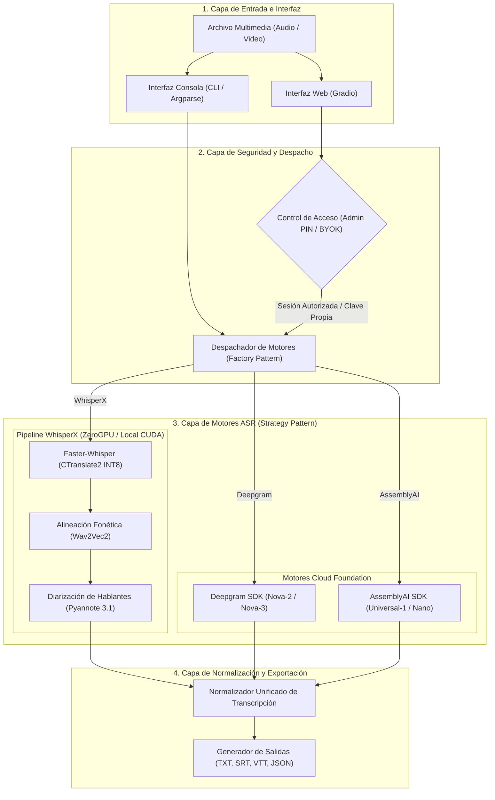
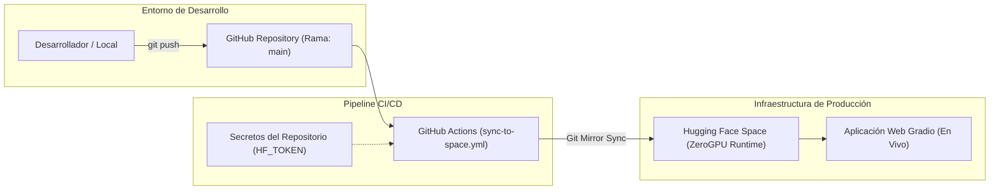

# Transcriptor Suite — Pipeline de Transcripción y Diarización Neuronal

[](https://huggingface.co/spaces/Klopezxd/transcriptor-suite)


> Pipeline de transcripción de audio y video con alineación fonética a nivel de palabra y diarización de locutores basado en WhisperX, Pyannote Audio, Deepgram y AssemblyAI.

*Read this document in English: [README.md](README.md)*

---

> [!IMPORTANT]
> ## Arquitectura de Credenciales y Configuración de Secretos
>
> La plataforma opera en un entorno de integración continua entre **GitHub** y **Hugging Face Spaces**, con soporte para ejecución local y servicios en la nube. A continuación se detalla la configuración requerida para cada nivel de la infraestructura:
>
> ### 1. Sincronización Automática en GitHub Actions (`HF_TOKEN`)
> * **Propósito:** Autorizar al flujo de trabajo automatizado (`.github/workflows/sync-to-hf.yml`) a desplegar las actualizaciones del código fuente directamente al repositorio del Space en Hugging Face ([Klopezxd/transcriptor-suite](https://huggingface.co/spaces/Klopezxd/transcriptor-suite)).
> * **Requisitos del Token:** Token de acceso personal generado en [Hugging Face Tokens](https://huggingface.co/settings/tokens) con rol **Escritura (`Write`)**.
> * **Ubicación de Configuración:**
>   1. Acceder al repositorio en GitHub: [transcriptor-suite](https://github.com/Klopezxd/transcriptor-suite).
>   2. Navegar a **Settings** ➔ **Secrets and variables** ➔ **Actions**.
>   3. Seleccionar **New repository secret**.
>   4. Definir nombre: `HF_TOKEN` | Valor: Token con permisos de escritura (`hf_...`).
>
> ---
>
> ### 2. Modelos de Diarización en Hugging Face Spaces (`HF_TOKEN`)
> * **Propósito:** Permitir la descarga de los pesos preentrenados de segmentación y diarización de locutores de Pyannote Audio cuando se ejecuta el motor WhisperX en ZeroGPU o local.
> * **Requisito Previo de Licencia:** La cuenta de Hugging Face debe aceptar formalmente los términos de uso en los dos repositorios oficiales de modelos:
>   * [pyannote/speaker-diarization-3.1](https://huggingface.co/pyannote/speaker-diarization-3.1)
>   * [pyannote/segmentation-3.0](https://huggingface.co/pyannote/segmentation-3.0)
> * **Ubicación de Configuración:**
>   1. Acceder a la configuración del Space: [huggingface.co/spaces/Klopezxd/transcriptor-suite/settings](https://huggingface.co/spaces/Klopezxd/transcriptor-suite/settings).
>   2. Navegar a **Variables and secrets** ➔ **New secret**.
>   3. Definir nombre: `HF_TOKEN` | Valor: Token de lectura (`hf_...`).
>
> ---
>
> ### 3. Proveedores de Inferencia en la Nube (Opcionales)
> * **Deepgram API (`DEEPGRAM_API_KEY`):** Para procesamiento por lotes de alta velocidad mediante modelos de la familia Nova con diarización acústica integrada.
>   * Clave obtenible en [Deepgram Console](https://console.deepgram.com).
> * **AssemblyAI API (`ASSEMBLYAI_API_KEY`):** Para transcripción de máxima resolución fonética mediante arquitecturas Conformer (Universal-1) y Nano.
>   * Clave obtenible en [AssemblyAI Dashboard](https://www.assemblyai.com).
> * **Ubicación de Configuración:** En los secretos del Space de Hugging Face (`Settings > Variables and secrets`), en el archivo local `.env`, o suministrados dinámicamente en tiempo de ejecución en la interfaz de usuario.
> ---
>
> ### 4. PIN Maestro de Administrador (`ADMIN_PIN`)
> * **Propósito:** Blindar tus claves de Deepgram y AssemblyAI para que visitantes o compañeros no puedan consumir tus créditos en la web pública.
> * **Comportamiento:** 
>   * Si un visitante accede a la web, solo puede usar WhisperX (gratuito en ZeroGPU) o ingresar su propia clave.
>   * Al ingresar tu contraseña mediante el botón **Admin**, la aplicación habilita las claves guardadas como secretos en Hugging Face Spaces. El acceso por URL está deshabilitado. Tras cinco intentos fallidos desde un mismo cliente, se bloquean los intentos restantes durante la ventana de un minuto.
> * **Ubicación de Configuración:** En los secretos del Space (`Settings > Variables and secrets > New secret`) con el nombre `ADMIN_PIN`.
>
> ---
>
> ### Matriz de Especificación de Secretos
>
> | Identificador | Proveedor | Ámbito de Configuración | Nivel de Requisito | Función en el Sistema |
> | :--- | :--- | :--- | :--- | :--- |
> | **`HF_TOKEN`** *(Write)* | Hugging Face | **GitHub Actions Secrets** | Mandatorio para CI/CD | Sincronización automática de código fuente hacia Hugging Face Spaces. |
> | **`HF_TOKEN`** *(Read)* | Hugging Face | **HF Space Secrets** o Web UI | Requerido para WhisperX | Acceso y descarga de modelos neuronales de Pyannote Audio. |
> | **`DEEPGRAM_API_KEY`** | Deepgram | **HF Space Secrets**, Web UI o `.env` | Opcional | Inferencia externa con modelos Nova sin consumo de cuota ZeroGPU. |
> | **`ASSEMBLYAI_API_KEY`** | AssemblyAI | **HF Space Secrets**, Web UI o `.env` | Opcional | Inferencia externa con modelos Conformer/Nano sin consumo de cuota ZeroGPU. |
> | **`ADMIN_PIN`** | Propietario | **HF Space Secrets** o `.env` | Recomendado | Autoriza el uso automático de credenciales maestras sin exponerlas al público. |


## Características Principales

* **Inferencia de Alto Rendimiento:** Basado en **WhisperX** (faster-whisper / CTranslate2), hasta $5\times$ más rápido que implementaciones tradicionales de Whisper.
* **Alineación Fonética Precisa:** Integra modelos **Wav2Vec2** para alinear fonéticamente marcas de tiempo exactas por palabra.
* **Diarización de Hablantes:** Identifica y segmenta interlocutores automáticamente mediante **Pyannote Audio 3.1**.
* **Optimización de Memoria (4GB VRAM & ZeroGPU):** Diseñado con cuantización `INT8` y recolección forzada de memoria entre fases, permitiendo ejecución fluida tanto en GPUs de consumo (ej. NVIDIA GTX 1650 con 4GB VRAM) como en **Hugging Face ZeroGPU**.
* **Doble Interfaz (Web + CLI):**
  * **Web UI (Gradio):** Interfaz para navegador con controles de parámetros en tiempo real.
  * **CLI (Terminal):** Soporte completo de argumentos por consola (`argparse`) con selector gráfico interactivo de respaldo.
* **Ingeniería de Software:** Tipado estricto (Type Hints), logging estructurado, pipeline desacoplado y gestión segura de credenciales vía variables de entorno.

---

## Demo en Vivo

Puedes probar el pipeline directamente en la nube sin configuración local:

👉 **[Abrir en Hugging Face Spaces: Klopezxd/transcriptor-suite](https://huggingface.co/spaces/Klopezxd/transcriptor-suite)**

---

## Arquitectura del Sistema

El funcionamiento del sistema se divide en dos procesos sencillos: cómo se procesa el audio y cómo se despliega el código automáticamente.

### 1. Arquitectura en Capas y Flujo de Procesamiento



### 2. Flujo de Despliegue Continuo (CI/CD)



---

## Taxonomía de Modelos y Evaluación de Rendimiento

A continuación se detalla la comparativa técnica y económica de los modelos implementados frente al catálogo completo de cada proveedor:

### 1. Modelos Deepgram (Arquitectura Nova)

| Modelo | Estado en la App | Velocidad Relativa | Tasa de Error (WER) | Coste Aprox. | Perfil de Aplicación |
| :--- | :--- | :--- | :--- | :--- | :--- |
| **`nova-2`** | **Por defecto** | **~40x Tiempo Real** | **Líder general** | ~$0.26 / hora | **Óptimo Calidad-Precio.** Máxima eficiencia para el 95% de transcripciones en español/inglés. |
| **`nova-3`** | **Disponible** | ~30x Tiempo Real | Superior en ruido | ~$0.31 / hora | **Alta Complejidad.** Recomendado para conferencias con voces superpuestas o acentos regionales difíciles. |
| `enhanced` | Descartado | ~15x Tiempo Real | Inferior a Nova-2 | ~$0.87 / hora | *Desaconsejado:* Modelo heredado de generación previa; coste 3.3x superior con menor precisión. |
| `base` | Descartado | ~20x Tiempo Real | Calidad básica | ~$0.75 / hora | *Desaconsejado:* Modelo legacy superado por Nova-2 tanto en coste como en fidelidad. |

### 2. Modelos AssemblyAI (Arquitecturas Conformer & Nano)

| Modelo | Estado en la App | Velocidad Relativa | Tasa de Error (WER) | Coste Aprox. | Perfil de Aplicación |
| :--- | :--- | :--- | :--- | :--- | :--- |
| **`best`** *(Universal-1)* | **Por defecto** | ~18x Tiempo Real | **Máxima Fidelidad** | ~$0.39 / hora | **Precisión Editorial.** Óptimo para vocabulario técnico, terminología académica y signos de puntuación. |
| **`nano`** | **Disponible** | ~35x Tiempo Real | Aceptable | ~$0.17 / hora | **Máximo Ahorro.** Ideal para borradores rápidos o procesamiento de gran volumen con bajo consumo de saldo. |

### 3. Modelos WhisperX (CTranslate2 + Wav2Vec2 + Pyannote 3.1)

| Modelo | Estado en la App | Parámetros | Velocidad en ZeroGPU | Coste de Cómputo | Perfil de Aplicación |
| :--- | :--- | :--- | :--- | :--- | :--- |
| **`large-v3-turbo`** | **Por defecto** | 809M | **~8x vs Large-v3** | **$0.00** *(Cuota ZeroGPU)* | **Estándar de Oro Abierto.** Misma exactitud que Large-v3 con la mitad de VRAM y tiempo de cómputo. |
| **`large-v3`** | **Disponible** | 1550M | Estándar (~180s/2h) | $0.00 *(Cuota ZeroGPU)* | Recomendado para lenguas con menor representación o sintaxis excepcional. |
| **`medium` / `small` / `base`** | **Disponibles** | 769M / 244M / 74M | Ultrarrápida | $0.00 *(Hardware limitado)* | Diseñados para entornos locales con menos de 4GB de VRAM. |

---

### 📂 Mapa de Archivos y Responsabilidades

Si en el futuro revisas este repositorio desde GitHub o Hugging Face sin tener la carpeta local, esta es la referencia exacta de dónde se encuentra cada módulo:

```text
transcriptor-suite/
│
├── app.py                  # Interfaz Web Gradio: Tema Aurora Boreal Nórdica, barra de estado v2.1.0,
│                           # selección reactiva de modelos y aislamiento de decorador @spaces.GPU.
│
├── main.py                 # Punto de entrada de consola (CLI): ejecución directa por argumentos
│                           # (--media, --model, --diarize) y selector gráfico interactivo de respaldo.
│
├── requirements.txt        # Dependencias esenciales del entorno (torch, whisperx, gradio, requests, pyannote).
├── CHANGELOG.md            # Historial formal de cambios siguiendo el estándar Keep a Changelog.
├── .env.example            # Plantilla de variables de entorno para desarrollo y pruebas locales.
│
├── .github/workflows/
│   ├── lint.yml            # Control de calidad: verificación de sintaxis con Ruff y suite de 73 pruebas unitarias.
│   └── sync-to-hf.yml      # Pipeline CI/CD: Valida calidad y sincroniza a Hugging Face Space si los tests pasan.
│
├── src/
│   ├── auth.py             # Control de acceso administrativo, limitador de intentos y aislamiento de IPs/sesiones.
│   ├── config.py           # Modelos de datos y configuraciones tipadas: ProviderType, WhisperModel,
│   │                       # DeepgramModel, AssemblyAIModel, PROVIDER_MODELS y TranscriptionConfig.
│   │
│   ├── transcriber.py      # Orquestador del pipeline: factoría create_transcription_pipeline,
│   │                       # gestión de VRAM, integración de Pyannote Audio y WhisperXPipeline.
│   │
│   ├── cloud_providers.py  # Conectores REST en la nube: DeepgramPipeline y AssemblyAIPipeline
│   │                       # con diarización nativa, polling asíncrono y sin consumo de GPU.
│   │
│   └── utils.py            # Utilidades: resolución jerárquica de API keys, escritura atómica,
│                           # barra de progreso continua en tiempo real y limpieza de VRAM.
│
└── tests/                  # Suite integral de 73 pruebas unitarias automatizadas (dominio, CLI, auth y UI).
```

---

### ⚡ Flujo de Ejecución por Motor

1. **Ruta WhisperX (Local o ZeroGPU en Hugging Face):**
   * **Consumo:** GPU local o cuota de minutos ZeroGPU (timeout fijado a 180s para audios de hasta 2 horas).
   * **Fases secuenciales con VRAM Flush:**
     * `Audio Loading` ➔ `WhisperX ASR` (CTranslate2) ➔ `Limpieza VRAM`
     * ➔ `Wav2Vec2 Alignment` ➔ `Limpieza VRAM`
     * ➔ `Pyannote 3.1 Diarization` (si está activa, usando `HF_TOKEN`) ➔ `Limpieza VRAM`.
2. **Ruta Cloud (Deepgram o AssemblyAI):**
   * **Consumo:** Cero GPU (0 segundos de cuota ZeroGPU consumida).
   * **Fases:** El archivo se procesa vía llamada HTTP directa usando tu API key (`DEEPGRAM_API_KEY` o `ASSEMBLYAI_API_KEY`), recibiendo la transcripción con diarización ya estructurada y transformándola al mismo formato unificado `TranscriptionResult`.

---

## Requisitos del Sistema

* **Sistema Operativo:** Windows 10/11 o Linux (Ubuntu 20.04+).
* **Python:** 3.10 (recomendado).
* **FFmpeg:** Instalado en el sistema y disponible en el `PATH`.
* **Hardware GPU (Opcional pero recomendado):** NVIDIA GeForce GTX 1650 o superior con drivers actualizados y soporte CUDA 12.x. (También funciona en CPU).

---

## Instalación Local

### Opción 1: Con Conda / Miniconda (Recomendado)

```bash
# 1. Clonar el repositorio
git clone https://github.com/Klopezxd/transcriptor-suite.git
cd transcriptor-suite

# 2. Crear el entorno aislado con Python 3.10
conda create -n transcriptor python=3.10 -y
conda activate transcriptor

# 3. Instalar PyTorch con aceleración CUDA 12.x
pip install torch==2.8.0 torchvision==0.23.0 torchaudio==2.8.0 --index-url https://download.pytorch.org/whl/cu126

# 4. Instalar WhisperX y dependencias del proyecto
pip install -r requirements.txt

# 5. Verificar aceleración GPU
python -c "import torch; print('CUDA disponible:', torch.cuda.is_available())"
```

### Opción 2: Con entorno virtual venv estándar

```bash
python -m venv venv
# En Windows:
.\venv\Scripts\activate
# En Linux:
source venv/bin/activate

pip install -r requirements.txt
```

---

## Configuración del Token de Hugging Face (Diarización)

La identificación de interlocutores requiere el modelo `pyannote/speaker-diarization-3.1`. Para utilizarlo:

1. Crea una cuenta gratuita en [Hugging Face](https://huggingface.co/).
2. Acepta los términos de uso en:
   * [pyannote/speaker-diarization-3.1](https://huggingface.co/pyannote/speaker-diarization-3.1)
   * [pyannote/segmentation-3.0](https://huggingface.co/pyannote/segmentation-3.0)
3. Genera un Token de lectura en [Hugging Face Settings](https://huggingface.co/settings/tokens).
4. Configúralo en tu entorno:
   ```bash
   # Copiar la plantilla de ejemplo
   cp .env.example .env
   # Editar .env y colocar:
   HF_TOKEN=hf_tu_token_aqui
   ```
   *También puedes pasarlo como argumento `--token` en la CLI.*

---

## Modos de Ejecución: Nube vs. Local

| Modo | Ideal para | Ventajas Principales | Limitaciones |
|---|---|---|---|
| **Hugging Face Spaces (Nube)** | Audios cortos y medianos (< 20-30 min), acceso inmediato | Cero instalación; corre en GPU NVIDIA A10G (24GB VRAM) en la nube | Sujeto a cuotas diarias gratuitas de ZeroGPU |
| **Ejecución Local (PC)** | Grabaciones largas (1 a 5+ horas), lotes masivos, audios confidenciales | Sin límites de tiempo, 100% privado y offline | Utiliza hardware local (GPU/CPU) |

---

## Guía de Uso

### 1. Lanzador Rápido en Windows (1 Clic)

Haz doble clic en `run_transcriptor.bat` en la raíz del proyecto (o ejecútalo desde terminal). Detecta y activa el entorno Conda automáticamente y abre la ventana gráfica para elegir tu archivo.

---

### 2. Interfaz Web Local (Gradio)

Lanza la misma interfaz web directamente en tu máquina:

```bash
python app.py
```
Abre tu navegador en `http://127.0.0.1:7860` para usar la interfaz visual.

---

### 3. Interfaz de Línea de Comandos (CLI)

```bash
# Modo interactivo (abre ventana gráfica para elegir el archivo si no pasas -i):
python cli.py

# Transcripción directa con modelo turbo:
python cli.py -i "video_clase.mp4" -m large-v3-turbo

# Transcripción con Diarización (identificación de personas):
python cli.py -i "reunion.mp4" -d

# Guardar en carpeta específica con formato de marcas de tiempo en rango:
python cli.py -i "conferencia.wav" --timestamps range -o "./transcripciones"
```

#### Opciones CLI disponibles:

| Flag | Tipo | Descripción | Por defecto |
|---|---|---|---|
| `-i`, `--input` | String | Ruta al archivo multimedia. Si se omite, abre selector gráfico. | `None` |
| `-m`, `--model` | Choice | `large-v3-turbo`, `large-v3`, `medium`, `small`, `base` | `large-v3-turbo` |
| `-d`, `--diarize` | Flag | Activa la identificación de hablantes (requiere token). | `False` |
| `--timestamps` | Choice | Formato de tiempo: `simple`, `range`, `none` | `simple` |
| `-t`, `--token` | String | Token explícito de Hugging Face. | Variable `HF_TOKEN` |
| `--compute-type` | Choice | Cuantización: `int8` (recomendado 4GB), `float16`, `float32` | `int8` |
| `-o`, `--output-dir` | String | Directorio destino para el `.txt`. | Mismo del archivo |

---

## Estructura del Proyecto

```text
transcriptor-suite/
├── .github/
│   └── workflows/
│       ├── sync-to-hf.yml       # CI/CD: Sincronización automática con Hugging Face Spaces
│       └── lint.yml             # Análisis estático de código con Ruff
├── src/
│   ├── __init__.py
│   ├── config.py                # Dataclasses inmutables y enums
│   ├── transcriber.py           # Pipeline orquestador WhisperX + Pyannote
│   └── utils.py                 # Funciones puras de VRAM, formateo y seguridad
├── app.py                       # Interfaz Web Gradio (Local + ZeroGPU)
├── cli.py                       # Interfaz CLI avanzada
├── requirements.txt             # Dependencias Python
├── packages.txt                 # Dependencias del SO (FFmpeg en HF Spaces)
├── environment.yml              # Definición de entorno Conda
├── .env.example                 # Plantilla de credenciales
├── .gitignore                   # Exclusión estricta de medios y temporales
├── pyproject.toml               # Configuración de empaquetado y linters
├── LICENSE                      # Licencia MIT
├── README.md                    # Documentación principal en Inglés
└── README.es.md                 # Documentación en Español
```

---

## Licencia y Autoría

* **Autor:** [Klever López](https://github.com/Klopezxd)
* **Licencia:** MIT License — libre para uso personal, académico y comercial.

