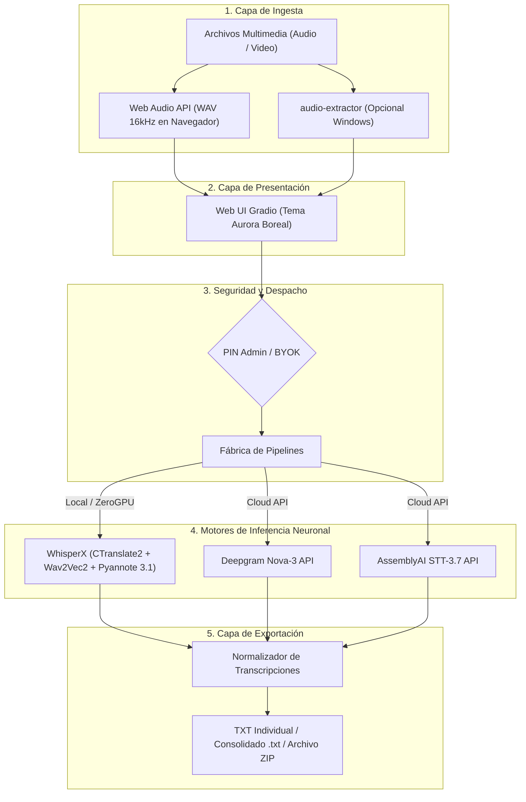

# Transcriptor Suite — Pipeline de Transcripción y Diarización Neuronal

[](https://huggingface.co/spaces/Klopezxd/transcriptor-suite)


> Pipeline modular y de alto rendimiento para transcripción de audio/video, alineación fonética a nivel de palabra y diarización de interlocutores. Integra **WhisperX**, **Pyannote Audio 3.1**, **Deepgram Nova** y **AssemblyAI STT-3.7**.

*Read this document in English: [README.md](README.md)*

---

### 🚀 Demo Interactiva en Vivo

Prueba la aplicación directamente en tu navegador sin necesidad de instalación local:

👉 **[Abrir en Hugging Face Spaces: Klopezxd/transcriptor-suite](https://huggingface.co/spaces/Klopezxd/transcriptor-suite)**

---

## Características Principales

* **Ecosistema Multi-Motor ASR:**
  * **WhisperX (ZeroGPU / Local):** Faster-Whisper (CTranslate2 INT8) con alineación fonética Wav2Vec2 y diarización Pyannote 3.1. Hasta $5\times$ más rápido que Whisper clásico.
  * **Deepgram (Cloud API):** Procesamiento ultra rápido por lotes con **Nova-3** (óptimo para ruido, acentos y solapamiento) y **Nova-2** (económico).
  * **AssemblyAI (Cloud API):** Máxima fidelidad editorial y comprensión contextual con **AssemblyAI-STT-3.7** y **Universal-2**.
* **Cola Inteligente de Transcripción («Dejarlo Trabajando»):** Haz clic en *Iniciar Transcripción* en cualquier momento, incluso mientras los archivos se analizan u optimizan. La tarea entra en cola automáticamente y arranca sola al completar la carga.
* **Extracción de Audio sin Pérdida en Cliente (Web Audio API):** Los videos (`.mp4`, `.mov`, `.mkv`, etc.) se demuxean y remuestrean localmente en el navegador a 16 kHz Mono WAV PCM, reduciendo el peso de subida entre un **90% y 98%** con 0% de pérdida acústica.
* **Extractor Externo Opcional ([`audio-extractor`](https://github.com/Klopezxd/audio-extractor)):** Para grabaciones pesadas de OBS Studio o videos de más de 450 MB en Windows, descarga [`extraer_audio.bat`](https://github.com/Klopezxd/audio-extractor/releases/latest/download/extraer_audio.bat) y extrae audio `.m4a` por Stream Copy en **2 segundos** antes de subirlo.
* **Interfaz Visual Aurora Boreal Adaptable:** Diseño modular en Gradio con adaptación fluida en tiempo real entre pantalla completa de escritorio (2 columnas simétricas) y pantalla dividida / snap (`<= 1024px`) con desplazamiento vertical nativo.
* **Procesamiento por Lotes, Pausa Segura y Doble Descarga:** Cola secuencial FIFO con progreso en tiempo real por archivo, pausa cooperativa entre archivos con reanudación sin duplicar trabajo, descarga del lote en archivo ZIP y exportación de un único archivo de texto consolidado (`.txt`) con separadores claros.
* **Optimizado para ZeroGPU y GPUs Dedicadas:** Compatible con Hugging Face ZeroGPU (con respaldo progresivo ante OOM y CPU) gracias a la cuantización INT8 y liberación agresiva de memoria VRAM entre fases.

---

## Modelos y Motores Soportados

| Proveedor | Motor | Modelo | Rendimiento | Ideal Para | Coste de Cómputo |
| :--- | :--- | :--- | :--- | :--- | :--- |
| **WhisperX** | ZeroGPU / Local | **`large-v3-turbo`** *(Por defecto)* | ~8x vs Large-v3 | Estándar de oro open-source y alineación fonética | **Gratis** *(ZeroGPU / GPU propia)* |
| **WhisperX** | ZeroGPU / Local | `large-v3`, `medium`, `small`, `base` | Rápido a Ultra-rápido | Idiomas poco representados o menor huella VRAM | **Gratis** *(ZeroGPU / GPU propia)* |
| **AssemblyAI** | Cloud REST | **`assemblyai-stt-3-7`** *(Por defecto)* | ~20x Tiempo Real | Máxima fidelidad editorial, términos técnicos y acentos | Pago por uso API |
| **AssemblyAI** | Cloud REST | `universal-2` | ~25x Tiempo Real | Transcripción balanceada de alta precisión | Pago por uso API |
| **Deepgram** | Cloud REST | **`nova-3`** *(Por defecto)* | ~30x Tiempo Real | Ruido de fondo, múltiples locutores y dialectos | Pago por uso API |
| **Deepgram** | Cloud REST | `nova-2` | ~40x Tiempo Real | Velocidad en segundos y máxima eficiencia de coste | Pago por uso API |

---

## Inicio Rápido

### Aplicación Web (Hugging Face Spaces / Gradio)

La forma principal y recomendada de usar la suite es directamente desde **[Hugging Face Spaces](https://huggingface.co/spaces/Klopezxd/transcriptor-suite)** sin instalar dependencias ni requerir GPU local.

Si deseas levantar la interfaz web para desarrollo o pruebas:

```bash
# Clonar el repositorio
git clone https://github.com/Klopezxd/transcriptor-suite.git
cd transcriptor-suite

# Instalar dependencias (Python 3.10 recomendado)
pip install -r requirements.txt

# Ejecutar la aplicación web
python app.py
```
Abre `http://localhost:7860` en tu navegador.

---

## Arquitectura del Sistema



---

## Configuración de Credenciales y Privacidad

Todas las credenciales del servidor (`HF_TOKEN`, `DEEPGRAM_API_KEY` y `ASSEMBLYAI_API_KEY`) definidas como **Secretos del Space** o en `.env` son **privadas por defecto** y únicamente se desbloquean tras iniciar sesión como **Admin**. Los usuarios invitados pueden introducir sus propias credenciales temporales directamente en la interfaz web (BYOK):

| Variable / Secreto | Proveedor | Ámbito | ¿Obligatorio? | Función Principal |
| :--- | :--- | :--- | :--- | :--- |
| **`HF_TOKEN`** | Hugging Face | Secretos Space (Privado Admin) / BYOK | Solo con Diarización | Descarga Pyannote 3.1. Privado por defecto; invitados usan campo BYOK salvo activar `ALLOW_PUBLIC_HF_TOKEN`. |
| **`DEEPGRAM_API_KEY`** | Deepgram | Secretos Space (Privado Admin) / BYOK | Opcional | Habilita transcripción en la nube con modelos Deepgram Nova exclusivamente en sesión Admin (o BYOK). |
| **`ASSEMBLYAI_API_KEY`** | AssemblyAI | Secretos Space (Privado Admin) / BYOK | Opcional | Habilita transcripción en la nube con AssemblyAI STT-3.7 / Universal-2 exclusivamente en sesión Admin (o BYOK). |
| **`ADMIN_PIN_HASH`** / **`ADMIN_PIN`** | Propietario | Secretos Space / `.env` | Recomendado | Desbloquea las claves privadas del servidor en la Web UI mediante sesión tokenizada (soporta hash `scrypt` con `ADMIN_PIN_HASH`). |
| **`ALLOW_PUBLIC_HF_TOKEN`** | Variables HF | Configuración Space | Opcional (Defecto: `false`) | Mantener en `false` para uso privado. Si es `true`, permite a invitados usar el `HF_TOKEN` del servidor en WhisperX. |
| **`MAX_UPLOAD_SIZE_MB`** | Variables HF | Configuración Space | Opcional (Defecto: `2gb`) | Límite máximo de archivo en MB enteros (ej. `1024`); si se omite aplica `2gb` por defecto. |
| **`TRUSTED_PROXY_IPS`** | Variables HF | Configuración Space | Opcional | IPs/CIDRs de proxies confiables para validar cabeceras `X-Forwarded-For` / `CF-Connecting-IP` en rate limiting. |
| **`TRUST_PROXY_HEADERS`** | Variables HF | Configuración Space | Opcional (Defecto: `false`) | En `true`, habilita la lectura de cabeceras de proxy confiable cuando el entorno opera detrás de reverse proxy. |
| **`ZERO_GPU_DURATION`** | Variables HF | Configuración Space | Opcional (Defecto: `60`) | Tiempo máximo asignado por ejecución en ZeroGPU (segundos). |

> [!TIP]
> **Diarización con WhisperX:** Para usar la diarización de interlocutores con WhisperX, acepta las condiciones en Hugging Face para [pyannote/speaker-diarization-3.1](https://huggingface.co/pyannote/speaker-diarization-3.1) y [pyannote/segmentation-3.0](https://huggingface.co/pyannote/segmentation-3.0), y suministra tu `HF_TOKEN` con permiso de lectura.

---

## Estructura del Proyecto

```text
transcriptor-suite/
├── app.py                  # Orquestador web Gradio (reactividad, layout, sesiones Admin y ZeroGPU)
├── assets/                 # Activos de frontend (Aurora theme.css y ui_enhancements.js)
├── src/
│   ├── auth.py             # Seguridad Admin, rate limiting por IP/global y anti-spoofing
│   ├── config.py           # Enums, catálogos de modelos y modelos de datos tipados
│   ├── transcriber.py      # Pipeline WhisperX, alineación Wav2Vec2 y respaldo OOM/VRAM
│   ├── cloud_providers.py  # Conectores REST para Deepgram y AssemblyAI (cero uso de GPU)
│   ├── ui/                 # Componentes modulares Gradio (Navbar, Subida, Opciones, Resultados, Modal)
│   └── utils.py            # Validación multimedia, ZIP seguro, progreso, caché y formateadores
├── tests/                  # Suite automatizada de pruebas (108 tests unitarios de regresión)
├── .gitattributes          # Normalización de finales de línea LF
├── packages.txt            # Dependencias de sistema (ffmpeg) para Hugging Face Spaces
├── requirements.txt        # Dependencias de paquetes Python fijadas
└── pyproject.toml          # Metadatos del paquete y configuración del linter Ruff
```

---

## Licencia y Autoría

* **Autor:** [Klever López](https://github.com/Klopezxd)
* **Licencia:** [MIT License](LICENSE) — Código abierto para proyectos académicos, personales y comerciales.
