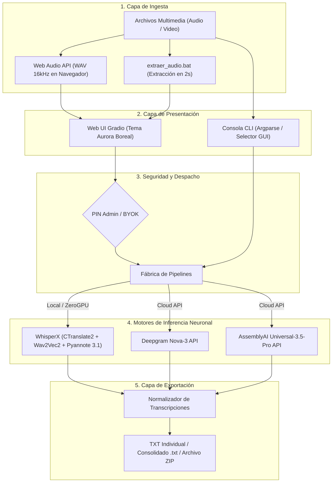

# Transcriptor Suite — Pipeline de Transcripción y Diarización Neuronal

[](https://huggingface.co/spaces/Klopezxd/transcriptor-suite)


> Pipeline modular y de alto rendimiento para transcripción de audio/video, alineación fonética a nivel de palabra y diarización de interlocutores. Integra **WhisperX**, **Pyannote Audio 3.1**, **Deepgram Nova** y **AssemblyAI Universal-3.5-Pro**.

*Read this document in English: [README.md](README.md)*

---

### 🚀 Demo Interactiva en Vivo

Prueba la aplicación directamente en tu navegador sin necesidad de instalación local:

👉 **[Abrir en Hugging Face Spaces: Klopezxd/transcriptor-suite](https://huggingface.co/spaces/Klopezxd/transcriptor-suite)**

---

## Características Principales

* **Ecosistema Multi-Motor ASR:**
  * **WhisperX (Local / ZeroGPU):** Faster-Whisper (CTranslate2 INT8) con alineación fonética Wav2Vec2 y diarización Pyannote 3.1. Hasta $5\times$ más rápido que Whisper clásico.
  * **Deepgram (Cloud API):** Procesamiento ultra rápido por lotes con **Nova-3** (óptimo para ruido, acentos y solapamiento) y **Nova-2** (económico).
  * **AssemblyAI (Cloud API):** Máxima fidelidad editorial y comprensión contextual con **Universal-3.5-Pro** y **Universal-2**.
* **Cola Inteligente de Transcripción («Dejarlo Trabajando»):** Haz clic en *Iniciar Transcripción* en cualquier momento, incluso mientras los archivos se analizan u optimizan. La tarea entra en cola automáticamente y arranca sola al completar la carga.
* **Extracción de Audio sin Pérdida en Cliente (Web Audio API):** Los videos (`.mp4`, `.mov`, `.mkv`, etc.) se demuxean y remuestrean localmente en el navegador a 16 kHz Mono WAV PCM, reduciendo el peso de subida entre un **90% y 98%** con 0% de pérdida acústica.
* **Extractor de Escritorio Cero-Python (`extraer_audio.bat`):** Arrastra y suelta grabaciones pesadas de OBS Studio o videos de más de 1.5 GB sobre el archivo para extraer audio nativo `.m4a` por Stream Copy en **2 segundos**, sin tocar Python.
* **Interfaz Visual Aurora Boreal Adaptable:** Diseño modular en Gradio con adaptación fluida en tiempo real entre pantalla completa de escritorio (2 columnas simétricas) y pantalla dividida / snap (`<= 1024px`) con desplazamiento vertical nativo.
* **Procesamiento por Lotes y Doble Descarga:** Cola secuencial FIFO con progreso en tiempo real por archivo, descarga del lote en archivo ZIP y exportación de un único archivo de texto consolidado (`.txt`) con separadores claros.
* **Optimizado para 4 GB VRAM y ZeroGPU:** Compatible con GPUs domésticas y Hugging Face ZeroGPU gracias a la cuantización INT8 y liberación agresiva de memoria VRAM entre fases.

---

## Modelos y Motores Soportados

| Proveedor | Motor | Modelo | Rendimiento | Ideal Para | Coste de Cómputo |
| :--- | :--- | :--- | :--- | :--- | :--- |
| **WhisperX** | Local / ZeroGPU | **`large-v3-turbo`** *(Por defecto)* | ~8x vs Large-v3 | Estándar de oro open-source y alineación fonética | **Gratis** *(ZeroGPU / Local)* |
| **WhisperX** | Local / ZeroGPU | `large-v3`, `medium`, `small`, `base` | Rápido a Ultra-rápido | Idiomas poco representados o hardware limitado (<4GB) | **Gratis** *(ZeroGPU / Local)* |
| **AssemblyAI** | Cloud REST | **`universal-3-5-pro`** *(Por defecto)* | ~20x Tiempo Real | Máxima fidelidad editorial, términos técnicos y acentos | Pago por uso API |
| **AssemblyAI** | Cloud REST | `universal-2` | ~25x Tiempo Real | Transcripción balanceada de alta precisión | Pago por uso API |
| **Deepgram** | Cloud REST | **`nova-3`** *(Por defecto)* | ~30x Tiempo Real | Ruido de fondo, múltiples locutores y dialectos | Pago por uso API |
| **Deepgram** | Cloud REST | `nova-2` | ~40x Tiempo Real | Velocidad en segundos y máxima eficiencia de coste | Pago por uso API |

---

## Inicio Rápido

### 1. Lanzador Directo en Windows (Escritorio)

Haz doble clic en `run_transcriptor.bat` en la raíz del proyecto para iniciar el entorno y abrir el selector gráfico.

### 2. Aplicación Web Local (Gradio)

```bash
# Clonar el repositorio
git clone https://github.com/Klopezxd/transcriptor-suite.git
cd transcriptor-suite

# Instalar dependencias (Python 3.10 recomendado)
pip install -r requirements.txt

# Ejecutar la aplicación web
python app.py
```
Abre `http://localhost:7860` en tu navegador.

### 3. Interfaz de Línea de Comandos (CLI)

```bash
# Modo interactivo (abre selector gráfico si no se indican archivos):
python cli.py

# Transcribir un archivo con WhisperX turbo:
python cli.py -i "clase.mp4" -m large-v3-turbo

# Transcribir con diarización de hablantes:
python cli.py -i "entrevista.mp3" -d -t "hf_tu_token_aqui"

# Procesamiento por lotes con carpeta de salida personalizada:
python cli.py -i "audio1.wav" "audio2.m4a" --timestamps range -o "./transcripciones"
```

---

## Arquitectura del Sistema



---

## Configuración de Credenciales

La plataforma admite variables en archivo local `.env`, claves dinámicas en la interfaz web (BYOK) y secretos en Hugging Face Spaces:

| Variable / Secreto | Proveedor | Ámbito | ¿Obligatorio? | Función Principal |
| :--- | :--- | :--- | :--- | :--- |
| **`HF_TOKEN`** | Hugging Face | Secretos Space / Web UI | Solo con Diarización | Descarga los modelos neuronales de Pyannote 3.1. |
| **`DEEPGRAM_API_KEY`** | Deepgram | Secretos Space / Web UI / `.env` | Opcional | Permite transcripción en la nube con modelos Nova. |
| **`ASSEMBLYAI_API_KEY`** | AssemblyAI | Secretos Space / Web UI / `.env` | Opcional | Permite transcripción en la nube con Universal-3.5-Pro. |
| **`ADMIN_PIN`** | Propietario | Secretos Space / `.env` | Recomendado | Desbloquea las claves del servidor en la Web UI de forma segura. |
| **`ZERO_GPU_DURATION`** | Variables HF | Configuración Space | Opcional (Defecto: `60`) | Tiempo máximo asignado por ejecución en ZeroGPU (segundos). |

> [!TIP]
> **Diarización con WhisperX:** Para usar la diarización de interlocutores con WhisperX, acepta las condiciones en Hugging Face para [pyannote/speaker-diarization-3.1](https://huggingface.co/pyannote/speaker-diarization-3.1) y [pyannote/segmentation-3.0](https://huggingface.co/pyannote/segmentation-3.0), y suministra tu `HF_TOKEN` con permiso de lectura.

---

## Estructura del Proyecto

```text
transcriptor-suite/
├── app.py                  # Orquestador web Gradio (reactividad, diseño visual, gancho ZeroGPU)
├── cli.py                  # Interfaz de consola con selector gráfico interactivo de respaldo
├── extraer_audio.bat       # Extractor de audio nativo para Windows (Cero Python)
├── run_transcriptor.bat    # Lanzador de escritorio para Windows
├── assets/                 # Activos de frontend (Aurora theme.css y ui_enhancements.js)
├── src/
│   ├── auth.py             # Seguridad de administrador, limitador de tasa y aislamiento de IPs
│   ├── config.py           # Enums, catálogos de modelos y modelos de datos tipados
│   ├── transcriber.py      # Pipeline WhisperX, alineación Wav2Vec2 y gestión de VRAM
│   ├── cloud_providers.py  # Conectores REST para Deepgram y AssemblyAI (cero uso de GPU)
│   ├── ui/                 # Componentes modulares Gradio (Navbar, Subida, Opciones, Resultados, Modal)
│   └── utils.py            # Validación de audio, empaquetado ZIP, notificador de progreso y formato
├── tests/                  # Suite automatizada de pruebas (91 tests unitarios de regresión)
├── requirements.txt        # Dependencias de paquetes Python
└── pyproject.toml          # Metadatos del paquete y configuración del linter Ruff
```

---

## Licencia y Autoría

* **Autor:** [Klever López](https://github.com/Klopezxd)
* **Licencia:** [MIT License](LICENSE) — Código abierto para proyectos académicos, personales y comerciales.
