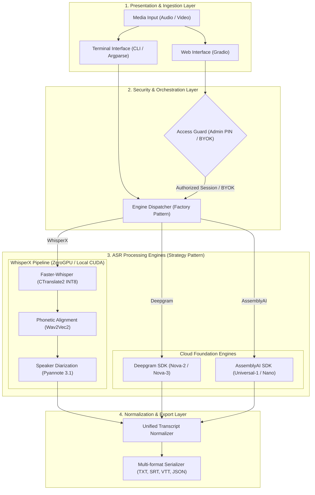
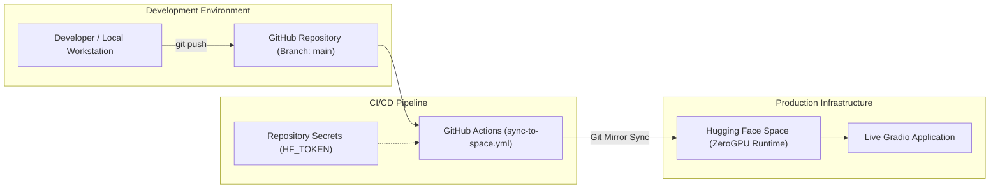

# Transcriptor Suite — Neural Speech Recognition & Diarization Pipeline

[](https://huggingface.co/spaces/Klopezxd/transcriptor-suite)


> High-throughput speech transcription pipeline featuring word-level phoneme alignment and speaker diarization using WhisperX, Pyannote Audio, Deepgram, and AssemblyAI.

*Leer este documento en Español: [README.es.md](README.es.md)*

---

> [!IMPORTANT]
> ## Credential Architecture & Secret Management
>
> The system operates across a continuous deployment lifecycle bridging **GitHub** and **Hugging Face Spaces**, supporting both local execution and external cloud foundation services. The configuration breakdown by infrastructure tier is detailed below:
>
> ### 1. Automated Deployment via GitHub Actions (`HF_TOKEN`)
> * **Purpose:** Authorizes the automated synchronization pipeline (`.github/workflows/sync-to-hf.yml`) to deploy repository updates directly to the Hugging Face Space repository ([Klopezxd/transcriptor-suite](https://huggingface.co/spaces/Klopezxd/transcriptor-suite)) upon `git push`.
> * **Token Scope:** Personal Access Token created in [Hugging Face Settings > Access Tokens](https://huggingface.co/settings/tokens) with **Write (`Write`)** role.
> * **Configuration Steps:**
>   1. Navigate to the GitHub repository: [transcriptor-suite](https://github.com/Klopezxd/transcriptor-suite).
>   2. Go to **Settings** ➔ **Secrets and variables** ➔ **Actions**.
>   3. Click **New repository secret**.
>   4. Set **Name:** `HF_TOKEN` | **Secret:** Your write-scoped token (`hf_...`).
>
> ---
>
> ### 2. Diarization Neural Models in Hugging Face Spaces (`HF_TOKEN`)
> * **Purpose:** Authorizes runtime downloads of pre-trained Pyannote Audio speaker segmentation and diarization weights when using the WhisperX engine under local or ZeroGPU execution.
> * **Mandatory Model Licenses:** The authenticated account must formally accept user agreements on both model repositories:
>   * [pyannote/speaker-diarization-3.1](https://huggingface.co/pyannote/speaker-diarization-3.1)
>   * [pyannote/segmentation-3.0](https://huggingface.co/pyannote/segmentation-3.0)
> * **Configuration Steps:**
>   1. Open the Space settings: [huggingface.co/spaces/Klopezxd/transcriptor-suite/settings](https://huggingface.co/spaces/Klopezxd/transcriptor-suite/settings).
>   2. Scroll to **Variables and secrets** ➔ **New secret**.
>   3. Set **Name:** `HF_TOKEN` | **Value:** Your read-scoped token (`hf_...`).
>
> ---
>
> ### 3. Cloud Foundation ASR Engines (Optional)
> * **Deepgram API (`DEEPGRAM_API_KEY`):** Provides sub-minute batch processing powered by Nova speech foundation architectures with integrated word-level diarization. Obtainable at [Deepgram Console](https://console.deepgram.com).
> * **AssemblyAI API (`ASSEMBLYAI_API_KEY`):** Provides high-precision acoustic speech processing powered by Conformer (Universal-1) and Nano architectures. Obtainable at [AssemblyAI Dashboard](https://www.assemblyai.com).
> ---
>
> ### 4. Master Administration PIN (`ADMIN_PIN`)
> * **Purpose:** Shields your personal Deepgram and AssemblyAI API keys from public consumption when sharing the Space URL.
> * **Behavior:**
>   * Public visitors are restricted to free WhisperX (ZeroGPU) or supplying their own personal API keys.
>   * Use the **Admin** button and your password to enable the API keys stored as Hugging Face Spaces secrets. URL authentication is disabled. After five failed attempts from the same client, further attempts are blocked for the remainder of a one-minute window.
> * **Configuration Steps:** Set in Space Secrets (`Settings > Variables and secrets > New secret`) under the key `ADMIN_PIN`.
>
> ---
>
> ### Credential Specification Matrix
>
> | Identifier | Provider | Configuration Scope | Requirement Level | Primary Function |
> | :--- | :--- | :--- | :--- | :--- |
> | **`HF_TOKEN`** *(Write)* | Hugging Face | **GitHub Actions Secrets** | Mandatory for CI/CD | Automatic code deployment to Hugging Face Spaces on push. |
> | **`HF_TOKEN`** *(Read)* | Hugging Face | **HF Space Secrets** or Web UI | Required for WhisperX | Authorizes neural model downloads for Pyannote Audio. |
> | **`DEEPGRAM_API_KEY`** | Deepgram | **HF Space Secrets**, Web UI or `.env` | Optional | External Nova batch inference bypassing GPU compute limits. |
> | **`ASSEMBLYAI_API_KEY`** | AssemblyAI | **HF Space Secrets**, Web UI or `.env` | Optional | External Conformer/Nano inference bypassing GPU compute limits. |
> | **`ADMIN_PIN`** | Space Owner | **HF Space Secrets** or `.env` | Recommended | Authorizes automatic server master credentials without public exposure. |


## Key Features

* **High-Throughput ASR:** Powered by **WhisperX** (faster-whisper / CTranslate2), delivering up to $5\times$ speedups over vanilla Whisper implementations.
* **Word-Level Phoneme Alignment:** Incorporates **Wav2Vec2** acoustic models to achieve exact word-boundary timestamp alignment.
* **Speaker Diarization:** Identifies and segments discrete speakers seamlessly using **Pyannote Audio 3.1**.
* **Consumer GPU & ZeroGPU Ready:** Architected with `INT8` quantization and explicit VRAM garbage collection between pipeline stages, running efficiently on 4GB VRAM cards (e.g., NVIDIA GeForce GTX 1650) as well as **Hugging Face ZeroGPU** runners.
* **Dual Interface (Web + CLI):**
  * **Web UI (Gradio):** Interactive browser application.
  * **CLI (Terminal):** Fully featured command-line interface with interactive graphical file picker fallback.
* **Production Engineering:** Explicit type hints, structured logging, decoupled domain logic, and secure environment-based credential handling.

---

## Live Interactive Demo

Test the pipeline directly on Hugging Face Spaces:

👉 **[Launch on Hugging Face Spaces: Klopezxd/transcriptor-suite](https://huggingface.co/spaces/Klopezxd/transcriptor-suite)**

---

## System Architecture

The system workflow consists of two simple, decoupled processes: how audio files are transcribed, and how code is continuously deployed.

### 1. Layered Architecture & Processing Pipeline



### 2. Continuous Deployment Pipeline (CI/CD)



---

## Model Taxonomy & Performance Evaluation

Technical and economic comparison of implemented speech recognition models relative to each provider's full catalog:

### 1. Deepgram Models (Nova Foundation Architecture)

| Model | Pipeline Status | Relative Throughput | Word Error Rate (WER) | Estimated Cost | Deployment Profile |
| :--- | :--- | :--- | :--- | :--- | :--- |
| **`nova-2`** | **Default** | **~40x Real-Time** | **Benchmark Leader** | ~$0.26 / hour | **Optimal Price-to-Performance.** Best general accuracy and fastest throughput for standard speech. |
| **`nova-3`** | **Supported** | ~30x Real-Time | Superior in Noise | ~$0.31 / hour | **Acoustic Robustness.** Recommended for accented speech, overlapping speakers, or ambient noise. |
| `enhanced` | Deprecated | ~15x Real-Time | Inferior to Nova-2 | ~$0.87 / hour | *Not Recommended:* Legacy generation model with 3.3x higher cost and inferior accuracy. |
| `base` | Deprecated | ~20x Real-Time | Baseline Quality | ~$0.75 / hour | *Not Recommended:* Legacy architecture superseded by Nova-2 across all metrics. |

### 2. AssemblyAI Models (Conformer & Nano Architectures)

| Model | Pipeline Status | Relative Throughput | Word Error Rate (WER) | Estimated Cost | Deployment Profile |
| :--- | :--- | :--- | :--- | :--- | :--- |
| **`best`** *(Universal-1)* | **Default** | ~18x Real-Time | **Editorial Fidelity** | ~$0.39 / hour | **Maximum Precision.** Ideal for specialized vocabulary, academic nomenclature, and strict syntax. |
| **`nano`** | **Supported** | ~35x Real-Time | Acceptable | ~$0.17 / hour | **Cost-Optimized.** Lightweight model suitable for rough drafts, indexing, and high-volume pipelines. |

### 3. WhisperX Models (CTranslate2 + Wav2Vec2 + Pyannote 3.1)

| Model | Pipeline Status | Parameters | ZeroGPU Throughput | Compute Cost | Deployment Profile |
| :--- | :--- | :--- | :--- | :--- | :--- |
| **`large-v3-turbo`** | **Default** | 809M | **~8x vs Large-v3** | **$0.00** *(ZeroGPU quota)* | **Open-Weights Gold Standard.** Same accuracy as Large-v3 with half the VRAM and compute latency. |
| **`large-v3`** | **Supported** | 1550M | Standard (~180s/2h) | $0.00 *(ZeroGPU quota)* | High-capacity model recommended for low-resource languages or edge dialects. |
| **`medium` / `small` / `base`** | **Supported** | 769M / 244M / 74M | Ultra-fast | $0.00 *(Resource-limited)* | Tailored for low-memory environments (<4GB VRAM). |

---

### 📂 Project Structure & Module Responsibilities

If you need to audit or manage this repository in the future without a local clone, here is the exact architectural breakdown of each component:

```text
transcriptor-suite/
│
├── app.py                  # Gradio Web Interface: Nordic Aurora theme, academic statusbar v2.1.0,
│                           # reactive model dropdowns, and isolated @spaces.GPU decorator execution.
│
├── main.py                 # Terminal CLI entry point: direct parameter execution (--media, --model,
│                           # --diarize) with interactive graphical file picker fallback.
│
├── requirements.txt        # Runtime dependencies (torch, whisperx, gradio, requests, pyannote).
├── CHANGELOG.md            # Formal versioning and release notes conforming to Keep a Changelog.
├── .env.example            # Environment variable template for local development and secrets testing.
│
├── .github/workflows/
│   ├── lint.yml            # Code Quality: Ruff linter check and 72 automated regression unit tests.
│   └── sync-to-hf.yml      # CI/CD Workflow: Validates quality and syncs commits to Hugging Face Spaces.
│
├── src/
│   ├── auth.py             # Admin access protection, attempt rate-limiter, and reverse-proxy IP isolation.
│   ├── config.py           # Strongly typed data models and enums: ProviderType, WhisperModel,
│   │                       # DeepgramModel, AssemblyAIModel, PROVIDER_MODELS, and TranscriptionConfig.
│   │
│   ├── transcriber.py      # Pipeline factory: create_transcription_pipeline, VRAM memory managers,
│   │                       # Pyannote Audio integration, and local WhisperXPipeline orchestrator.
│   │
│   ├── cloud_providers.py  # Lightweight cloud REST connectors: DeepgramPipeline & AssemblyAIPipeline
│   │                       # featuring word-level diarization, async polling, and ZERO GPU usage.
│   │
│   └── utils.py            # Utility helpers: hierarchical API key resolution, atomic file writes,
│                           # real-time continuous progress notifier, and VRAM garbage collectors.
│
└── tests/                  # Comprehensive suite of 72 automated unit tests (domain, CLI, auth, and web UI).
```

---

### ⚡ Engine Execution Lifecycle

1. **WhisperX Pipeline (Local GPU or Hugging Face ZeroGPU):**
   * **Compute Cost:** Local GPU VRAM or Hugging Face ZeroGPU minutes (timeout set to 180s for files up to ~2 hours).
   * **Sequential Stages with VRAM Eviction:**
     * `Audio Loading` ➔ `WhisperX ASR` (CTranslate2) ➔ `VRAM Flush`
     * ➔ `Wav2Vec2 Alignment` ➔ `VRAM Flush`
     * ➔ `Pyannote 3.1 Diarization` (if enabled, authenticated via `HF_TOKEN`) ➔ `VRAM Flush`.
2. **Cloud Pipelines (Deepgram & AssemblyAI):**
   * **Compute Cost:** Zero GPU compute (0 seconds consumed from ZeroGPU quotas).
   * **Stages:** Raw media is streamed or uploaded over HTTPS authenticated with `DEEPGRAM_API_KEY` or `ASSEMBLYAI_API_KEY`. Word/utterance timestamps and speaker labels are normalized into the standard `TranscriptionResult` object.

---

## System Requirements

* **OS:** Windows 10/11 or Linux (Ubuntu 20.04+).
* **Python:** 3.10 (recommended).
* **FFmpeg:** Installed and exported to system `PATH`.
* **Hardware GPU (Optional):** NVIDIA GeForce GTX 1650 or greater with CUDA 12.x support (CPU fallback fully supported).

---

## Installation & Setup

### Conda Environment (Recommended)

```bash
# Clone the repository
git clone https://github.com/Klopezxd/transcriptor-suite.git
cd transcriptor-suite

# Create and activate isolated Python 3.10 environment
conda create -n transcriptor python=3.10 -y
conda activate transcriptor

# Install PyTorch with CUDA 12.x wheel
pip install torch==2.8.0 torchvision==0.23.0 torchaudio==2.8.0 --index-url https://download.pytorch.org/whl/cu126

# Install dependencies
pip install -r requirements.txt

# Verify CUDA acceleration
python -c "import torch; print('CUDA Ready:', torch.cuda.is_available())"
```

---

## Hugging Face Authentication (Speaker Diarization)

Speaker diarization leverages gated models from Pyannote. To enable it:

1. Create a free account at [Hugging Face](https://huggingface.co/).
2. Accept model usage terms:
   * [pyannote/speaker-diarization-3.1](https://huggingface.co/pyannote/speaker-diarization-3.1)
   * [pyannote/segmentation-3.0](https://huggingface.co/pyannote/segmentation-3.0)
3. Generate a read-access token under [Hugging Face Settings](https://huggingface.co/settings/tokens).
4. Export the token:
   ```bash
   cp .env.example .env
   # Add your token to .env:
   HF_TOKEN=hf_your_token_here
   ```

---

## Execution Modes: Cloud vs. Local

| Execution Mode | Best For | Key Advantage | Constraints |
|---|---|---|---|
| **Hugging Face Spaces (Cloud)** | Short-to-medium files (< 20-30 mins), instant access | Zero install; runs on cloud NVIDIA A10G (24GB VRAM) | Subject to daily ZeroGPU community quotas |
| **Local Execution (PC)** | Long recordings (1 to 5+ hours), batch jobs, private/sensitive data | Unlimited processing time, 100% offline privacy | Uses local machine hardware (GPU/CPU) |

---

## Usage

### 1. Windows One-Click Launcher (Desktop)

Double-click `run_transcriptor.bat` in the project root (or run it via terminal). It automatically activates the `transcriptor` environment and opens the graphical file picker dialog.

---

### 2. Local Web Application (Gradio)

Run the full interactive web application locally on your machine:

```bash
python app.py
```
Navigate to `http://127.0.0.1:7860` in any modern web browser.

---

### 3. Command Line Interface (CLI)

```bash
# Interactive mode (opens file selection dialog if no -i argument is provided):
python cli.py

# Direct processing with turbo model:
python cli.py -i "lecture.mp4" -m large-v3-turbo

# Enable multi-speaker diarization:
python cli.py -i "interview.mp4" -d

# Custom output directory with range timestamps:
python cli.py -i "meeting.wav" --timestamps range -o "./transcripts"
```

#### Available CLI Arguments:

| Flag | Type | Description | Default |
|---|---|---|---|
| `-i`, `--input` | String | Path to media file (launches GUI picker if omitted). | `None` |
| `-m`, `--model` | Choice | `large-v3-turbo`, `large-v3`, `medium`, `small`, `base` | `large-v3-turbo` |
| `-d`, `--diarize` | Flag | Enables speaker diarization (requires token). | `False` |
| `--timestamps` | Choice | Timestamp formatting: `simple`, `range`, `none` | `simple` |
| `-t`, `--token` | String | Hugging Face token override. | `HF_TOKEN` env |
| `--compute-type` | Choice | Quantization: `int8` (recommended for 4GB), `float16`, `float32` | `int8` |
| `-o`, `--output-dir` | String | Output folder for `.txt` transcripts. | Source directory |

---

## Repository Structure

```text
transcriptor-suite/
├── .github/
│   └── workflows/
│       ├── sync-to-hf.yml       # Continuous Deployment to Hugging Face Spaces
│       └── lint.yml             # Code quality and linting via Ruff
├── src/
│   ├── __init__.py
│   ├── config.py                # Strongly typed dataclasses & enums
│   ├── transcriber.py           # Core decoupled WhisperX orchestration pipeline
│   └── utils.py                 # Pure helper functions, memory management, and security
├── app.py                       # Gradio Web UI entrypoint (Local + ZeroGPU)
├── cli.py                       # Advanced CLI entrypoint
├── requirements.txt             # Python dependencies
├── packages.txt                 # OS packages (FFmpeg for Hugging Face Spaces)
├── environment.yml              # Conda environment definition
├── .env.example                 # Credential template
├── .gitignore                   # Strict exclusions for artifacts and large media
├── pyproject.toml               # Modern packaging metadata & Ruff configuration
├── LICENSE                      # MIT License
├── README.md                    # English documentation (Primary)
└── README.es.md                 # Spanish documentation
```

---

## License & Authorship

* **Author:** [Klever López](https://github.com/Klopezxd)
* **License:** MIT License — Open source for academic, professional, and personal use.

