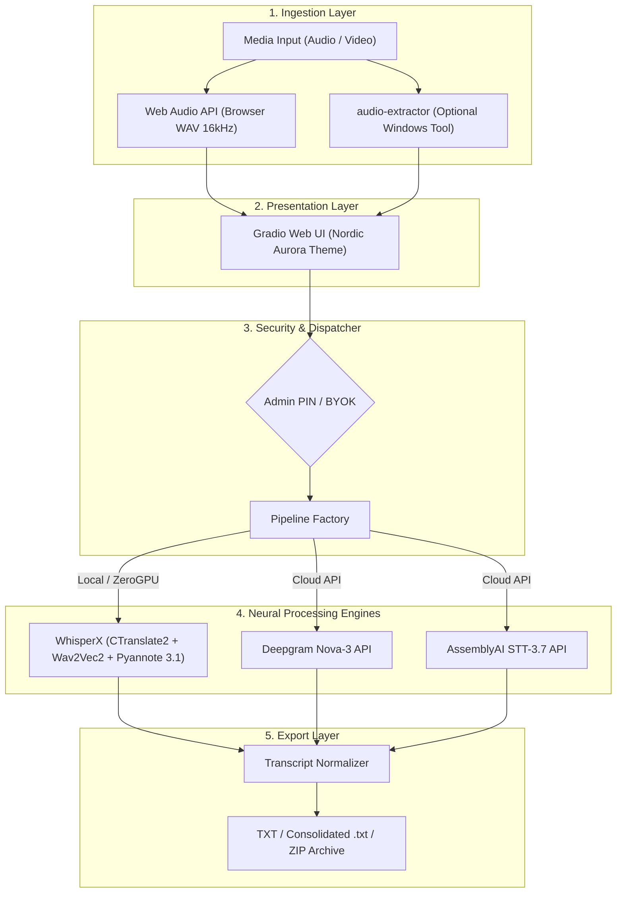

# Transcriptor Suite — Neural Speech Recognition & Diarization Pipeline

[](https://huggingface.co/spaces/Klopezxd/transcriptor-suite)


> High-throughput, multi-engine speech transcription pipeline featuring word-level phonetic alignment and speaker diarization. Powered by **WhisperX**, **Pyannote Audio 3.1**, **Deepgram Nova**, and **AssemblyAI STT-3.7**.

*Leer este documento en Español: [README.es.md](README.es.md)*

---

### 🚀 Live Interactive Demo

Test the pipeline directly in your browser without local setup:

👉 **[Launch on Hugging Face Spaces: Klopezxd/transcriptor-suite](https://huggingface.co/spaces/Klopezxd/transcriptor-suite)**

---

## Key Features

* **Multi-Engine ASR Ecosystem:**
  * **WhisperX (ZeroGPU / Local):** Faster-Whisper (CTranslate2 INT8) with Wav2Vec2 word alignment and Pyannote 3.1 diarization. Up to $5\times$ faster than vanilla Whisper.
  * **Deepgram (Cloud API):** Sub-minute batch processing with **Nova-3** (robust against noise & accents) and **Nova-2** (cost-effective).
  * **AssemblyAI (Cloud API):** High-fidelity acoustic accuracy with **AssemblyAI-STT-3.7** and **Universal-2**.
* **Smart Asynchronous Queue («Leave it Working»):** Click *Start Transcription* at any time—even while files are uploading or optimizing. The task queues automatically and begins processing as soon as uploads finish.
* **Client-Side Lossless Audio Extraction (Web Audio API):** Video files (`.mp4`, `.mov`, `.mkv`, etc.) are demuxed and resampled in-browser to 16 kHz Mono WAV PCM, reducing upload payloads by **90% to 98%** with zero quality loss.
* **Optional External Extractor ([`audio-extractor`](https://github.com/Klopezxd/audio-extractor)):** For heavy OBS or 4K video files (>450 MB) on Windows, download [`extraer_audio.bat`](https://github.com/Klopezxd/audio-extractor/releases/latest/download/extraer_audio.bat) to extract native `.m4a` audio via stream copy in **2 seconds** before uploading.
* **Responsive Aurora Boreal UI:** Modular Gradio interface with real-time adaptation between full-screen desktop (2-column symmetrical view) and snap/split-screen mode (`<= 1024px`) with fluid native scrolling.
* **Batch Processing, Safe Pause & Dual Export:** Sequential FIFO queue with per-file progress, cooperative per-file pause and resume without duplicating work, batch ZIP download, and consolidated single-file (`.txt`) export with clear separators.
* **ZeroGPU & Low-VRAM Ready:** Built for Hugging Face ZeroGPU (with progressive CUDA OOM backoff and CPU fallback) via INT8 quantization and aggressive phase-by-phase memory flush.

---

## Supported Speech Models

| Provider | Engine | Model | Throughput | Best For | Compute Cost |
| :--- | :--- | :--- | :--- | :--- | :--- |
| **WhisperX** | ZeroGPU / Local | **`large-v3-turbo`** *(Default)* | ~8x vs Large-v3 | Open-weights gold standard, phonetic alignment | **Free** *(ZeroGPU / Own GPU)* |
| **WhisperX** | ZeroGPU / Local | `large-v3`, `medium`, `small`, `base` | Fast to Ultra-fast | Low-resource languages or tighter VRAM budgets | **Free** *(ZeroGPU / Own GPU)* |
| **AssemblyAI** | Cloud REST | **`assemblyai-stt-3-7`** *(Default)* | ~20x Real-Time | Editorial accuracy, strict terminology, accents | Pay-per-use API |
| **AssemblyAI** | Cloud REST | `universal-2` | ~25x Real-Time | Balanced high-precision transcription | Pay-per-use API |
| **Deepgram** | Cloud REST | **`nova-3`** *(Default)* | ~30x Real-Time | Background noise, overlapping speakers, dialects | Pay-per-use API |
| **Deepgram** | Cloud REST | `nova-2` | ~40x Real-Time | Sub-minute speed and maximum cost efficiency | Pay-per-use API |

---

## Quick Start

### Web UI (Hugging Face Spaces / Gradio)

The recommended way to use the suite is directly on **[Hugging Face Spaces](https://huggingface.co/spaces/Klopezxd/transcriptor-suite)** with zero local setup or GPU required.

To run the web interface for development or testing:

```bash
# Clone and enter the repository
git clone https://github.com/Klopezxd/transcriptor-suite.git
cd transcriptor-suite

# Install dependencies (Python 3.10 recommended)
pip install -r requirements.txt

# Run the web application
python app.py
```
Open `http://localhost:7860` in your browser.

---

## System Architecture



---

## Configuration & Credentials Privacy

All server credentials (`HF_TOKEN`, `DEEPGRAM_API_KEY`, and `ASSEMBLYAI_API_KEY`) configured as **Hugging Face Space Secrets** or in `.env` are **private by default** and unlocked only after signing in as **Admin**. Public guests can supply their own temporary BYOK keys directly in the Web UI without accessing server secrets:

| Secret / Variable | Provider | Scope | Mandatory? | Primary Function |
| :--- | :--- | :--- | :--- | :--- |
| **`HF_TOKEN`** | Hugging Face | Space Secrets (Admin-only) / BYOK | Only for Diarization | Downloads Pyannote 3.1 models. Private by default; guests use BYOK unless `ALLOW_PUBLIC_HF_TOKEN=true`. |
| **`DEEPGRAM_API_KEY`** | Deepgram | Space Secrets (Admin-only) / BYOK | Optional | Authorizes Deepgram Nova cloud transcription for Admin sessions (or guest BYOK). |
| **`ASSEMBLYAI_API_KEY`** | AssemblyAI | Space Secrets (Admin-only) / BYOK | Optional | Authorizes AssemblyAI STT-3.7 / Universal-2 cloud transcription for Admin sessions (or guest BYOK). |
| **`ADMIN_PIN_HASH`** / **`ADMIN_PIN`** | Owner | Space Secrets / `.env` | Recommended | Unlocks private server API keys in the Web UI via server-side tokenized session (supports `scrypt` hash via `ADMIN_PIN_HASH`). |
| **`ALLOW_PUBLIC_HF_TOKEN`** | Space Settings | HF Variables | Optional (Default: `false`) | Keep `false` for private operation. When `true`, lets public guests use the server `HF_TOKEN` for WhisperX. |
| **`MAX_UPLOAD_SIZE_MB`** | Space Settings | HF Variables | Optional (Default: `2gb`) | Maximum upload size in integer megabytes (e.g., `1024`); defaults to `2gb` when unset. |
| **`TRUSTED_PROXY_IPS`** | Space Settings | HF Variables | Optional | Trusted proxy IPs/CIDRs for `X-Forwarded-For` / `CF-Connecting-IP` headers in rate limiting. |
| **`TRUST_PROXY_HEADERS`** | Space Settings | HF Variables | Optional (Default: `false`) | When `true`, enables reading forwarded proxy headers when deployed behind a reverse proxy. |
| **`ZERO_GPU_DURATION`** | Space Settings | HF Variables | Optional (Default: `60`) | ZeroGPU timeout allocation in seconds. |

> [!TIP]
> **Speaker Diarization Note:** To enable Pyannote diarization with WhisperX, accept the model terms on Hugging Face for [pyannote/speaker-diarization-3.1](https://huggingface.co/pyannote/speaker-diarization-3.1) and [pyannote/segmentation-3.0](https://huggingface.co/pyannote/segmentation-3.0), then provide a read-scoped `HF_TOKEN`.

---

## Repository Structure

```text
transcriptor-suite/
├── app.py                  # Gradio Web Orchestrator (events, UI layout, Admin sessions, ZeroGPU)
├── assets/                 # Frontend assets (Aurora theme.css & ui_enhancements.js)
├── src/
│   ├── auth.py             # Admin security, IP/global rate limiting, proxy anti-spoofing
│   ├── config.py           # Enums, model catalogs, and typed configuration schemas
│   ├── transcriber.py      # WhisperX pipeline, Wav2Vec2 alignment, OOM/VRAM fallback
│   ├── cloud_providers.py  # Deepgram & AssemblyAI REST connectors (zero GPU usage)
│   ├── ui/                 # Modular Gradio cards (Navbar, Upload, Options, Results, Modal)
│   └── utils.py            # Audio validation, safe ZIP archiver, progress, cache & formatters
├── tests/                  # Automated test suite (108 unit & regression tests)
├── .gitattributes          # Enforces consistent LF line endings
├── packages.txt            # System packages (ffmpeg) for Hugging Face Spaces
├── requirements.txt        # Pinned Python package dependencies
└── pyproject.toml          # Packaging metadata & Ruff linter configuration
```

---

## License & Authorship

* **Author:** [Klever López](https://github.com/Klopezxd)
* **License:** [MIT License](LICENSE) — Open source for personal, academic, and commercial workflows.
