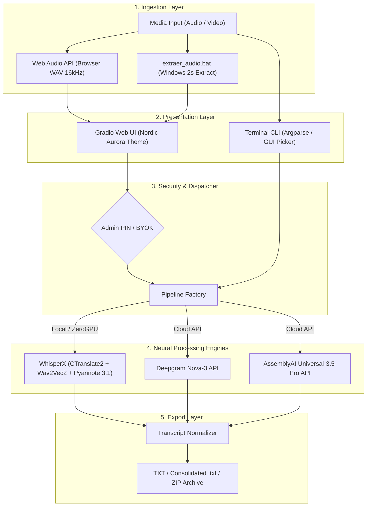

# Transcriptor Suite — Neural Speech Recognition & Diarization Pipeline

[](https://huggingface.co/spaces/Klopezxd/transcriptor-suite)


> High-throughput, multi-engine speech transcription pipeline featuring word-level phonetic alignment and speaker diarization. Powered by **WhisperX**, **Pyannote Audio 3.1**, **Deepgram Nova**, and **AssemblyAI Universal-3.5-Pro**.

*Leer este documento en Español: [README.es.md](README.es.md)*

---

### 🚀 Live Interactive Demo

Test the pipeline directly in your browser without local setup:

👉 **[Launch on Hugging Face Spaces: Klopezxd/transcriptor-suite](https://huggingface.co/spaces/Klopezxd/transcriptor-suite)**

---

## Key Features

* **Multi-Engine ASR Ecosystem:**
  * **WhisperX (Local / ZeroGPU):** Faster-Whisper (CTranslate2 INT8) with Wav2Vec2 word alignment and Pyannote 3.1 diarization. Up to $5\times$ faster than vanilla Whisper.
  * **Deepgram (Cloud API):** Sub-minute batch processing with **Nova-3** (robust against noise & accents) and **Nova-2** (cost-effective).
  * **AssemblyAI (Cloud API):** High-fidelity acoustic accuracy with **Universal-3.5-Pro** and **Universal-2**.
* **Smart Asynchronous Queue («Leave it Working»):** Click *Start Transcription* at any time—even while files are uploading or optimizing. The task queues automatically and begins processing as soon as uploads finish.
* **Client-Side Lossless Audio Extraction (Web Audio API):** Video files (`.mp4`, `.mov`, `.mkv`, etc.) are demuxed and resampled in-browser to 16 kHz Mono WAV PCM, reducing upload payloads by **90% to 98%** with zero quality loss.
* **Zero-Python Desktop Extractor (`extraer_audio.bat`):** Drag & drop heavy OBS or 4K video files (>1.5 GB) onto the script to extract native `.m4a` audio via stream copy in **2 seconds** without needing Python.
* **Responsive Aurora Boreal UI:** Modular Gradio interface with real-time adaptation between full-screen desktop (2-column symmetrical view) and snap/split-screen mode (`<= 1024px`) with fluid native scrolling.
* **Batch Processing & Dual Export:** Sequential FIFO queue with per-file progress, batch ZIP download, and consolidated single-file (`.txt`) export with clear separators.
* **Low VRAM & ZeroGPU Ready:** Runs on consumer GPUs (4 GB VRAM) and Hugging Face ZeroGPU via aggressive phase-by-phase memory flush and INT8 quantization.

---

## Supported Speech Models

| Provider | Engine | Model | Throughput | Best For | Compute Cost |
| :--- | :--- | :--- | :--- | :--- | :--- |
| **WhisperX** | Local / ZeroGPU | **`large-v3-turbo`** *(Default)* | ~8x vs Large-v3 | Open-weights gold standard, phonetic alignment | **Free** *(ZeroGPU / Local)* |
| **WhisperX** | Local / ZeroGPU | `large-v3`, `medium`, `small`, `base` | Fast to Ultra-fast | Low-resource languages or limited hardware (<4GB) | **Free** *(ZeroGPU / Local)* |
| **AssemblyAI** | Cloud REST | **`universal-3-5-pro`** *(Default)* | ~20x Real-Time | Editorial accuracy, strict terminology, accents | Pay-per-use API |
| **AssemblyAI** | Cloud REST | `universal-2` | ~25x Real-Time | Balanced high-precision transcription | Pay-per-use API |
| **Deepgram** | Cloud REST | **`nova-3`** *(Default)* | ~30x Real-Time | Background noise, overlapping speakers, dialects | Pay-per-use API |
| **Deepgram** | Cloud REST | `nova-2` | ~40x Real-Time | Sub-minute speed and maximum cost efficiency | Pay-per-use API |

---

## Quick Start

### 1. Windows One-Click Launcher (Desktop)

Double-click `run_transcriptor.bat` in the root folder. It activates the environment and opens the graphical picker.

### 2. Web UI (Gradio)

```bash
# Clone and enter the repository
git clone https://github.com/Klopezxd/transcriptor-suite.git
cd transcriptor-suite

# Install dependencies (Python 3.10 recommended)
pip install -r requirements.txt

# Run the web application
python app.py
```
Open `http://localhost:7860` in your browser.

### 3. Command Line Interface (CLI)

```bash
# Interactive mode (opens multi-file dialog if no file is provided):
python cli.py

# Transcribe a single file with WhisperX turbo:
python cli.py -i "meeting.mp4" -m large-v3-turbo

# Transcribe with speaker diarization:
python cli.py -i "interview.mp3" -d -t "hf_your_token_here"

# Batch transcription with custom output directory:
python cli.py -i "audio1.wav" "audio2.m4a" --timestamps range -o "./transcripts"
```

---

## System Architecture



---

## Configuration & Credentials

The system supports local `.env` files, web UI dynamic keys (BYOK), and Hugging Face Space secrets:

| Secret | Provider | Scope | Mandatory? | Primary Function |
| :--- | :--- | :--- | :--- | :--- |
| **`HF_TOKEN`** | Hugging Face | Space Secrets / Web UI | Only for Diarization | Downloads Pyannote 3.1 diarization models. |
| **`DEEPGRAM_API_KEY`** | Deepgram | Space Secrets / Web UI / `.env` | Optional | Authorizes Deepgram Nova cloud transcription. |
| **`ASSEMBLYAI_API_KEY`** | AssemblyAI | Space Secrets / Web UI / `.env` | Optional | Authorizes AssemblyAI Universal cloud transcription. |
| **`ADMIN_PIN`** | Owner | Space Secrets / `.env` | Recommended | Unlocks server API keys in the Web UI without public exposure. |
| **`ZERO_GPU_DURATION`** | Space Settings | HF Variables | Optional (Default: `60`) | ZeroGPU timeout allocation in seconds. |

> [!TIP]
> **Speaker Diarization Note:** To enable Pyannote diarization with WhisperX, accept the model terms on Hugging Face for [pyannote/speaker-diarization-3.1](https://huggingface.co/pyannote/speaker-diarization-3.1) and [pyannote/segmentation-3.0](https://huggingface.co/pyannote/segmentation-3.0), then provide your read-scoped `HF_TOKEN`.

---

## Repository Structure

```text
transcriptor-suite/
├── app.py                  # Gradio Web Orchestrator (events, UI layout, ZeroGPU hook)
├── cli.py                  # Command-line interface with interactive picker fallback
├── extraer_audio.bat       # Zero-Python Windows drag-and-drop audio extractor
├── run_transcriptor.bat    # Windows desktop launcher
├── assets/                 # Frontend assets (Aurora theme.css & ui_enhancements.js)
├── src/
│   ├── auth.py             # Admin security, brute-force rate limiting, client IP isolation
│   ├── config.py           # Enums, model catalogs, and typed configuration schemas
│   ├── transcriber.py      # WhisperX pipeline, Wav2Vec2 alignment, and VRAM management
│   ├── cloud_providers.py  # Deepgram & AssemblyAI REST connectors (zero GPU usage)
│   ├── ui/                 # Modular Gradio cards (Navbar, Upload, Options, Results, Modal)
│   └── utils.py            # Audio validation, ZIP archiver, progress notifier, formatters
├── tests/                  # Automated test suite (91 regression unit tests)
├── requirements.txt        # Python package dependencies
└── pyproject.toml          # Packaging metadata & Ruff linter configuration
```

---

## License & Authorship

* **Author:** [Klever López](https://github.com/Klopezxd)
* **License:** [MIT License](LICENSE) — Open source for personal, academic, and commercial workflows.
